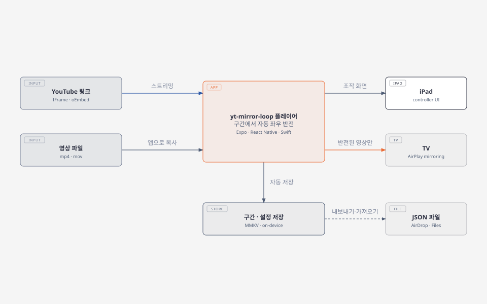
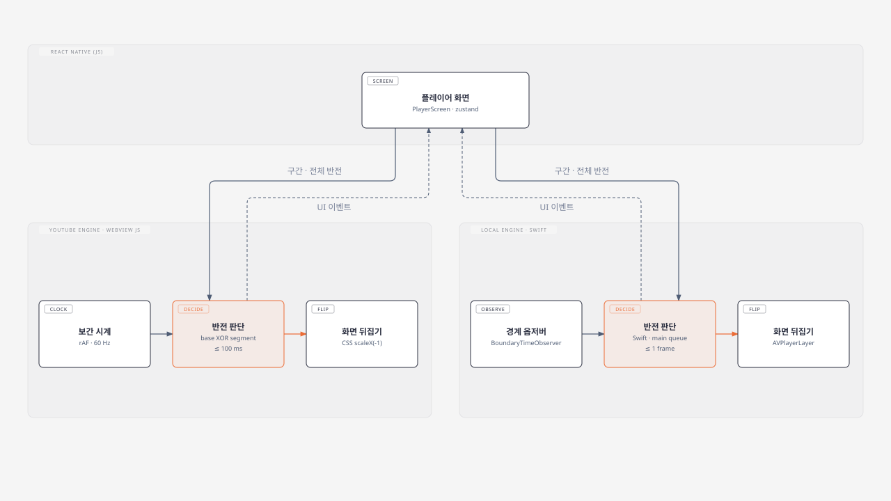
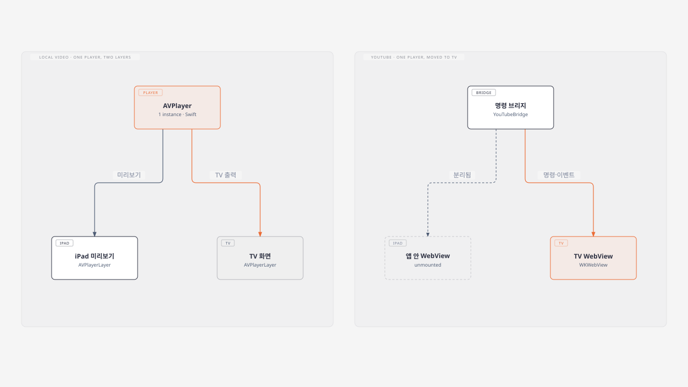
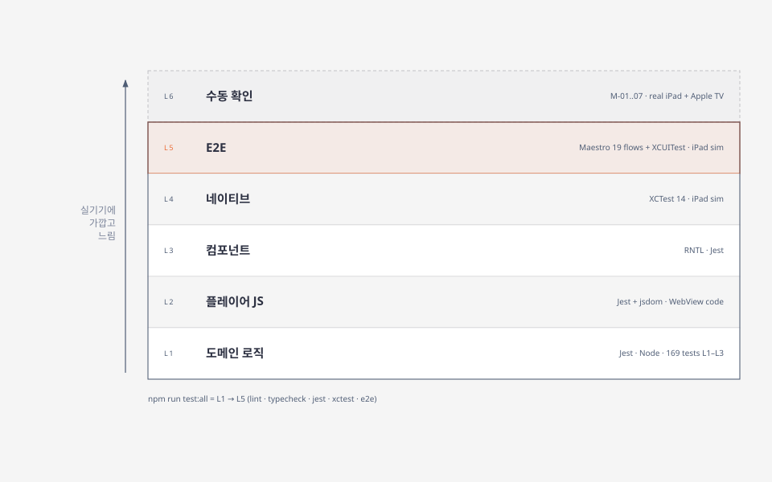

# yt-mirror-loop

iPad용 안무 연습 플레이어입니다. 유튜브 영상이나 기기에 있는 영상 파일에서 **정해 둔 구간만 자동으로 좌우 반전**하고, TV에 연결하면 **반전된 영상만** 크게 띄웁니다.

---

## 쉽게 말하면

거울 앞에서 춤을 배우면 따라 하기 쉽습니다. 내가 오른손을 들면 거울 속 사람도 화면의 같은 쪽 손을 들기 때문이죠. 그런데 안무 영상은 댄서가 **앞을 보다가 뒤로 돌기도** 합니다. 앞을 볼 때는 영상을 뒤집어야 거울처럼 보이고, 뒤를 볼 때는 원래대로 두어야 방향이 맞습니다. 매번 손으로 전환하면 연습 흐름이 끊깁니다.

이 앱은 그 전환을 대신해 줍니다.

1. 영상에서 "여기부터 여기까지 뒤집기"를 **구간으로 표시**합니다. 재생 중에 [시작 마크], [끝 마크]를 누르면 됩니다.
2. 재생하면 그 구간에 들어설 때 **알아서 좌우가 뒤집히고**, 벗어나면 원래대로 돌아옵니다.
3. 어려운 부분은 **A-B 반복**으로 계속 돌려 보고, 속도를 0.5배로 늦춰도 **음정은 그대로**입니다.
4. 제어 센터에서 **화면 미러링**으로 Apple TV에 연결하면 TV에는 반전된 영상만 나오고, iPad는 리모컨처럼 조작 화면이 됩니다.

표시해 둔 구간은 영상마다 iPad에 자동으로 저장됩니다. JSON 파일로 내보내 다른 iPad에 AirDrop으로 보낼 수도 있습니다. 영상 파일은 보내지 않고, 구간 정보만 보냅니다.



### 두 가지 영상 소스

| | 유튜브 링크 | 영상 파일 (mp4 · mov) |
|---|---|---|
| 넣는 법 | 링크 붙여넣기 (클립보드에 있으면 제안해 줌) | [파일에서 가져오기] 또는 [사진 보관함] |
| 반전 정확도 | 구간 경계에서 0.1초 이내 | 1프레임 이내 (30fps 기준 0.033초) |
| 프레임 단위 이동 | 안 됨 | ±1프레임 가능 |
| 인터넷 | 필요 | 필요 없음 (앱 안에 복사해 둠) |

> 앱을 **삭제**하면 가져온 영상 파일도 함께 지워집니다. 갱신(재서명)으로는 지워지지 않습니다. 중요한 구간 정보는 [내보내기]로 백업해 두세요.

설치 방법은 [docs/INSTALL.md](docs/INSTALL.md)에 있습니다. 앱스토어 없이 무료 Apple ID로 설치하고, SideStore로 7일마다 자동 갱신합니다.

---

## 개발자용 설명

### 기술 구성

- **앱:** Expo SDK 57, React Native 0.86 (New Architecture), expo-router, zustand, react-native-mmkv, zod
- **유튜브 엔진:** `react-native-webview` 안에서 YouTube IFrame API를 실행합니다. 반전과 반복 판단은 그 페이지 안의 JS가 합니다.
- **로컬 엔진:** 직접 만든 Expo 모듈 `modules/mirror-player`(Swift)가 `AVPlayer`를 소유합니다. 반전은 `AVPlayerLayer` transform, 구간 경계는 boundary time observer로 처리합니다.
- **테스트:** Jest, RNTL, XCTest, Maestro, XCUITest (iPadOS 시뮬레이터)

### 반전은 어디서 판단하나

화면을 뒤집는 판단을 React Native에서 하면 JS와 네이티브 사이를 오가는 지연 때문에 전환이 늦습니다. 그래서 RN은 **구간과 전체 반전 설정만 엔진에 보내고**, 실제 판단은 영상이 재생되는 곳 바로 옆에서 매 프레임 합니다.

- **유튜브:** WebView 안 JS가 `getCurrentTime()` 샘플 사이를 `requestAnimationFrame`으로 보간하고, 판단이 바뀌는 순간 CSS `scaleX(-1)`을 토글합니다.
- **로컬:** Swift가 모든 구간 경계에 boundary observer를 걸어 두고, 도달하면 레이어를 뒤집습니다. 탐색 직후에는 현재 시각으로 다시 계산합니다.

최종 반전 상태는 `전체 반전 XOR 구간 안`입니다. 전체 반전을 켜면 구간 안에서는 원본으로 보입니다.



### TV에 연결했을 때

외부 디스플레이가 연결되면 앱은 `UIWindowSceneSessionRoleExternalDisplayNonInteractive` scene을 받아 TV 쪽 창을 만듭니다. 두 엔진의 방식이 다릅니다.

- **로컬 영상:** 같은 `AVPlayer`에 레이어를 하나 더 붙입니다. 플레이어가 하나라서 iPad 미리보기와 TV 화면이 저절로 맞습니다.
- **유튜브:** 앱 안 WebView를 내리고 TV 쪽 `WKWebView`가 같은 플레이어 HTML을 재생합니다. 플레이어를 둘 두면 서로 어긋나기 때문에, 명령 브리지가 TV 쪽 하나에만 명령을 보냅니다.

연결이 끊기면 재생 위치를 유지한 채 iPad 단독 모드로 돌아옵니다.



### 폴더 구조

```
src/
  app/           expo-router 화면 (라이브러리, 플레이어, 설정, e2e 명령)
  domain/        순수 TS 로직: URL 파싱, 구간/XOR, A-B 루프, 스키마, 가져오기/내보내기, 충돌 처리
  engines/       PlayerBridge 인터페이스와 두 엔진
    youtube/player/  WebView 안에서 도는 JS (빌드 시 HTML에 인라인)
  screens/ components/ state/ services/ platform/ storage/
modules/mirror-player/ios/   Swift 모듈 (MirrorEngine, ExternalDisplayManager, AssetProbe) + XCTest
plugins/withMirrorPlayer.js  UIScene 라이프사이클, 외부 디스플레이 scene, 테스트 스펙 설정
e2e/flows/                   Maestro 플로우 (E-01~E-19)
scripts/                     e2e-ios.sh, test-native.sh, make-fixtures.sh, build-ipa.sh
docs/                        PRD, 구현 계획, 테스트 계획, 설치, 스파이크 결과, 다이어그램
```

`ios/`는 `expo prebuild`로 생성하는 폴더라 커밋하지 않습니다. 네이티브 설정은 모두 config plugin에 있습니다.

### 명령어

실제 iPad에서 개발할 때는 Xcode의 Settings → Accounts에서 Apple ID를 먼저
등록합니다. 무료 계정의 Personal Team도 사용할 수 있습니다. iPad의 개발자 모드를
켜고 USB로 연결한 뒤 `npm run ios:device`로 기기를 선택하면 Debug 앱 설치와
Metro 실행을 함께 진행합니다. 특정 기기는 `npm run ios:device -- <UDID>`로 선택합니다.
서명 인증서가 없다면 Xcode의 계정 화면에서 Manage Certificates → + → Apple
Development로 생성합니다.

설치 후 JS/TS 수정은 Fast Refresh로 반영됩니다. 다음 개발 세션에서는
`npm start -- --lan`으로 Metro를 켜고 개발용 앱을 엽니다. Mac과 iPad는 같은
네트워크에 연결해야 합니다. Swift 모듈이나 config plugin을 수정했다면
`npm run ios:device`로 다시 빌드합니다. 무료 서명은 만료되면 재설치해야 합니다.

| 명령 | 하는 일 |
|---|---|
| `npm run ios:device` | 연결된 iPad에 개발용 Debug 앱 설치 후 Metro 실행 |
| `npm run doctor` | Xcode, 시뮬레이터, CocoaPods, Maestro 등 환경 점검 |
| `npm test` | Jest (L1–L3), 커버리지 기준 적용 (`src/domain` 95%, 전체 80%) |
| `npm run test:native` | iPad 시뮬레이터에서 MirrorPlayer XCTest |
| `npm run e2e:ios` | E2E 빌드 → 시뮬레이터 설치 → Maestro 플로우 → 키보드 XCUITest |
| `npm run test:all` | lint → typecheck → test → test:native → e2e:ios (커밋 전 기준) |
| `npm run build:ipa` | 서명 없는 IPA 생성 (`build/yt-mirror-loop.ipa`) |

`e2e:ios`는 `SKIP_BUILD=1`(직전 빌드 재사용), `FLOWS=<파일|폴더>`(일부만 실행), `E2E_TAGS=offline`(네트워크 플로우 제외)을 받습니다.

### 테스트 계층



테스트 ID(U-*, P-*, C-*, N-*, E-*)와 기준은 [docs/TEST_PLAN.md](docs/TEST_PLAN.md)에 있습니다. 현재 Jest 169개, XCTest 14개, Maestro 19개 플로우, 키보드 XCUITest 1개가 모두 통과합니다.

### 알아둘 점

자세한 내용은 [docs/spikes/M0.md](docs/spikes/M0.md)에 있습니다.

- **iOS 27 SDK는 UIScene 라이프사이클이 필수**입니다. 없으면 앱이 실행 즉시 종료됩니다. `plugins/withMirrorPlayer.js`가 Expo 앱을 `ExpoAppSceneDelegate`로 전환합니다.
- **유튜브는 HLS로 재생**합니다. MediaSource 경로는 시뮬레이터에서 버퍼링만 하다 멈춰서, 모든 프레임에서 `(Managed)MediaSource`를 숨겨 네이티브 HLS로 넘어가게 합니다.
- **E2E는 딥링크 대신 명령 입력칸을 씁니다.** iOS 27은 `ytmirror://` 링크마다 "앱에서 열겠습니까?" 알림을 띄우는데, Maestro가 이를 누를 수 없습니다. E2E 빌드(`EXPO_PUBLIC_E2E=1`)에만 `e2e-cmd` 입력칸이 들어가며, 딥링크와 같은 명령을 실행합니다.
- **하드웨어 키보드 테스트(E-20)는 XCUITest**입니다. Maestro는 iOS에서 하드웨어 키를 보낼 수 없습니다.
- **`pod install`이 느리면** Maven Central이 느린 것입니다. 스크립트는 `ENTERPRISE_REPOSITORY`로 Google Maven 미러를 씁니다.

### 문서

- [docs/PRD.md](docs/PRD.md): 요구사항
- [docs/IMPLEMENTATION_PLAN.md](docs/IMPLEMENTATION_PLAN.md): 구현 단계와 결정 사항
- [docs/TEST_PLAN.md](docs/TEST_PLAN.md): 테스트 목록과 통과 기준
- [docs/spikes/M0.md](docs/spikes/M0.md): 스파이크 결과와 발견 사항
- [docs/INSTALL.md](docs/INSTALL.md): 설치와 자동 갱신

다이어그램 원본은 [docs/diagrams/diagrams.html](docs/diagrams/diagrams.html) 한 파일이고, README의 SVG는 여기서 내보낸 것입니다.
